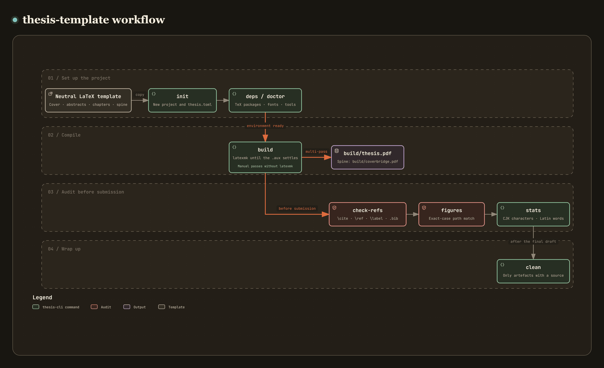

# thesis-cli — a master's thesis LaTeX template with build and audit tools

[](https://github.com/recklight/thesis-template/actions/workflows/ci.yml)
[](https://www.python.org/downloads/)
[](LICENSE)

English | [繁體中文](README.zh-TW.md)

A school-neutral LaTeX template for a master's thesis in Traditional Chinese, plus `thesis-cli`, a build and audit command-line tool written in Python. The university, the department and every name in it are placeholders (`UNIVERSITY NAME`, `Department Name`) until you fill them in.

The template does the typesetting: cover, title page, abstracts, table of contents, chapters, bibliography, appendix and the printed spine. The CLI compiles, checks and cleans up, and every command has a fixed exit status, so it can go straight into CI.

Author: RL

---

## Contents

- [Overview](#overview)
- [Installation](#installation)
- [Quick start](#quick-start)
- [Method](#method)
- [Usage examples](#usage-examples)
- [CLI reference](#cli-reference)
- [Project structure](#project-structure)
- [Configuration file thesis.toml](#configuration-file-thesistoml)
- [Data preparation](#data-preparation)
- [Exit codes and CI](#exit-codes-and-ci)
- [Output format](#output-format)
- [Design notes](#design-notes)
- [Development and testing](#development-and-testing)
- [References](#references)
- [License](#license)

---

## Overview

```
thesis-cli init     create a new project from the neutral template
thesis-cli deps     check TeX packages, programs and fonts before compiling
thesis-cli doctor   diagnose the Python environment, the project layout and the toolchain
thesis-cli build    compile the thesis (or the spine) with as many passes as the references need
thesis-cli check-refs  audit citations, bibliography, cross-references and labels
thesis-cli figures  resolve every graphic, catching case and path errors
thesis-cli stats    word count for mixed Chinese and English (characters for Chinese, words for English)
thesis-cli clean    remove build artefacts, never a source file
```

[](https://raw.githack.com/recklight/thesis-template/master/docs/workflow.html?theme=dark)

Interactive workflow diagram: [view online](https://raw.githack.com/recklight/thesis-template/master/docs/workflow.html?theme=dark), or open [`docs/workflow.html`](docs/workflow.html) in a browser. It can be zoomed and searched, and it marks the path between two steps, for example from `init` to `build/thesis.pdf`.

Each command catches a problem that LaTeX lets through, or mentions only in a log file:

| Problem | What LaTeX/BibTeX does | What you get | Command |
| --- | --- | --- | --- |
| One compile pass too few | One warning line in the `.log` | Cross-references print as `??` | `build` |
| A `\cite` key that no `.bib` defines | Warning | The citation prints as `[?]` | `check-refs` |
| A `.bib` entry nothing cites | Nothing | The entry is missing from the bibliography | `check-refs` |
| The same key with different content in two `.bib` files | One `Repeated entry` line in the `.blg` | Whichever copy is read first is used | `check-refs` |
| A graphics path whose case does not match | Works on Windows/NTFS | The build fails on Linux CI | `figures` |
| A missing sub-font of a CJK font | Exit status 0, a trace in `missfont.log` | A substituted font nobody notices | `deps`, `build` |
| Compiling a fragment that has no preamble | A screenful of `Undefined control sequence` | Messages that point nowhere near the real mistake | `build` |
| Build artefacts mixed in with the sources | Nothing | Another document's `.aux` travels along with the thesis | `build`, `clean` |

Every audit command accepts `--strict` (warnings become failures) and `--json` (for scripts), so the same commands serve a person at a terminal and a CI job.

---

## Installation

Requirements: **Python 3.10 or newer**, and a TeX distribution (TeX Live, MiKTeX or MacTeX).
The audit commands run without TeX; only `build` and the smoke test of `doctor` need a compiler.

`thesis-cli` is not published on PyPI; install it from a clone:

```bash
git clone https://github.com/recklight/thesis-template.git
cd thesis-template

# regular install
pip install .

# for development (editable, with pytest and ruff)
pip install -e ".[dev]"
```

There are four Python dependencies: `numpy`, `typer`, `rich` and `tomli`.

Then check the environment:

```bash
thesis-cli doctor
```

`doctor` checks the Python version and packages, the project layout and the TeX toolchain, in that order, and finally compiles a minimal Chinese document as a smoke test (in a temporary folder, leaving nothing behind).
Run outside a project folder, it skips the project layout and checks only the machine, with the built-in defaults.

---

## Quick start

```bash
# 1. create a new thesis project (asks for names, title and department)
thesis-cli init ~/my-thesis --interactive
cd ~/my-thesis

# 2. make sure the TeX installation is complete
thesis-cli deps

# 3. compile
thesis-cli build

# 4. the full check before submitting
thesis-cli check-refs --strict
thesis-cli figures --strict
thesis-cli stats

# 5. remove the build artefacts
thesis-cli clean
```

The compiled PDF is `build/thesis.pdf`.
The printed spine is a separate document:

```bash
thesis-cli build --target spine
```

---

## Method

### 1. Word count for mixed Chinese and English

Splitting on whitespace does not work for Chinese (a paragraph has no spaces, so it counts as one word), and counting characters does not work for the English abstract. So `stats` counts the two separately:

- Chinese: one per character, decided by the Unicode CJK blocks
  (the main block `U+4E00–U+9FFF`, Extensions A–J, the two compatibility ideograph blocks),
  plus the letters and numbers of the CJK Symbols and Punctuation block (`U+3000–U+303F`), such as 々 and the 〇 in 二〇二四.
- English: CJK characters are replaced by spaces, the rest is split on whitespace, and only tokens with a letter or digit count as words.
- Punctuation: counted on its own and in neither total. It covers the punctuation and symbol code points of `U+3001–U+303F`,
  the vertical forms (`U+FE10–U+FE1F`), the CJK compatibility forms (`U+FE30–U+FE4F`) and the punctuation ranges of fullwidth ASCII.
  Two things in these blocks are deliberately not punctuation: fullwidth digits (`U+FF10–U+FF19`) are digits and count as English words,
  and the ideographic space (`U+3000`) is whitespace, counted in neither total nor in the character count.

The classification is vectorised. Let $c_i$ be the code point of the $i$-th character,
and flatten the boundaries of all CJK blocks into one sorted array

$$
E = [\,s_0,\; e_0+1,\; s_1,\; e_1+1,\; \dots\,]
$$

A character is CJK exactly when

$$
\operatorname{searchsorted}(E,\, c_i,\, \text{right}) \bmod 2 = 1
$$

The whole text is encoded as UTF-32LE and the bytes are read back as one array of code points;
a single `np.searchsorted` call then decides the CJK test for all of them, with no Python loop over characters.

Before counting, `stats` strips comments, math, `lstlisting` blocks and every command and environment name,
and also the arguments that hold an identifier or a setting rather than text: the contents of `\label{}`, `\cite{}` and `\ref{}`,
the width, file and label of the `\fig` macro family, table column specs, and arguments that are only a number or a length.
Otherwise `\label{sec:sampling-rate}` would count as an English word and `\chapter{緒論}` would add `\chapter{` to the English count.
The text of `\caption` and the extra text of `\figt` are prose, so they are counted.

### 2. Four-way cross-reference audit

`check-refs` compares four sets; anything left over on either side is a problem:

| Comparison | What it catches | Severity |
| --- | --- | --- |
| `\cite` key ∉ `.bib` | The citation prints as `[?]` | error |
| `.bib` key ∉ any `\cite` | The entry never reaches the bibliography | warning |
| `\ref` target ∉ `\label` | The cross-reference prints as `??` | error |
| `\label` defined twice | A warning in the `.log`; the reference points at one of them | error |

It also reads the `.aux` left by the last build. A citation in the source that the `.aux` does not have means the PDF on disk is out of date (stale aux).

### 3. Graphics resolution and case checks

If the source says `\includegraphics{figures/case_1_test.eps}` and the file on disk is `Case_1_test.eps`,
the build works on Windows and on a default macOS volume and fails as soon as the project reaches Linux CI.

The resolver never asks the filesystem whether a file exists, because the answer depends on the platform.
It lists each directory (`Path.iterdir()`) and compares the requested path with what is there character by character, one level at a time.
Folder names are compared as well as the file name, so `Figures/plot.png` is also a case mismatch when the folder is `figures/`.

- exact match → `ok`
- matches only when case is ignored → `case-mismatch` (error, with the real path on disk)
- not found → `missing` (error, with the paths that were tried)
- the file name is built by a macro (the watermark, for one) → `macro` (info: cannot be resolved without TeX, so `build` checks it)

For a reference without an extension, `figures` tries each entry of `figures.extensions` in `thesis.toml` in order,
as LaTeX's `\DeclareGraphicsExtensions` does.
A reference that names an extension resolves only to that file; graphicx does not take `plot.pdf` for `plot.png`.
The one exception is `.eps`: pdfLaTeX uses the `plot-eps-converted-to.pdf` that `epstopdf` writes.
A second scan goes the other way and lists files in the figure folders that nothing references;
`*-eps-converted-to.pdf` files are derived output, so they are left out of that list and put on `clean`'s list instead.

### 4. Running passes until the references settle

Cross-references and citation numbers need two or more passes:
the first pass writes the numbers to the `.aux`, the second reads them, and after `bibtex` writes the `.bbl` one more pass is needed.

By default `build` leaves the pass count to `latexmk`, which runs until the `.aux` stops changing.
Without `latexmk` it falls back to a fixed sequence that runs the engine `build.max_passes` times (4 by default):

```
engine → bibtex → engine → engine → engine
```

When the first pass leaves no `\bibdata` in the `.aux` (the spine, or a document without a bibliography), `bibtex` is skipped;
a `bibtex` run that only printed warnings (exit status 1) is not a failure.
If `bibtex` is not installed at all, `build` logs a warning, skips the pass and carries on.

I support the `latex+dvipdfmx` route because it is the fastest for a long thesis:
`pdflatex` embeds the fonts on every pass, which is wasted work on all but the last, while `dvipdfmx` embeds them once at the end.

### 5. Safe clean-up rules

`clean` is the only command here that deletes anything, so its rules are fixed and narrow:

1. It only runs in a project that has a `thesis.toml`, and a candidate must lie under the project root (paths are resolved before the comparison; symbolic links are not followed).
2. A file is removed only while the source that produced it still exists.
   `thesis.aux` may go because `thesis.tex` is there.
   For `build/thesis.aux` the source is `thesis.tex` in the project root, and for `build/coverbridge.aux` it is the configured spine source.
   An orphan `other_project.aux` stays, because nothing shows it came from this project.
3. Sources are never candidates: `.tex`, `.cls`, `.sty`, `.bib`, `.bst` and every image format,
   whatever the configuration says.
4. The finished PDF is removed only with `--outputs` or when the configuration says so.

`--dry-run` shows the deletion plan without deleting anything.

---

## Usage examples

### CLI

```bash
# the full check before submitting, with warnings as failures (for CI)
thesis-cli check-refs --strict
thesis-cli figures --strict

# word count of the chapters only, as JSON for a script
thesis-cli stats --only-chapters --json | python -c "import json,sys; d=json.load(sys.stdin); print(d['summary']['cjk_chars'])"

# work on another project directory without cd-ing into it
thesis-cli -C ~/my-thesis build

# switch engines for one build without touching thesis.toml
thesis-cli build --engine pdflatex

# skip latexmk and run the fixed pass sequence
thesis-cli build --no-latexmk

# see what would be deleted, then delete it
thesis-cli clean --dry-run --show-skipped
thesis-cli clean
```

### Python API

The CLI is a thin layer: behind each command is a function that takes a configuration and returns a report.
None of them print or call `sys.exit`, so they work as a library:

```python
from pathlib import Path

from thesis_cli import (
    audit_figures,
    check_references,
    collect_statistics,
    load_config,
    scan_document,
)

# read thesis.toml (searched upwards from the given directory)
config = load_config(Path("~/my-thesis").expanduser(), required=True)

# expand the whole document: follow \input / \include, collect citations, labels and graphics
document = scan_document(
    config.main_path,
    config.root,
    macros=config.figure_macros,
    label_macros=config.label_macros,
)
print(f"{len(document.files)} files, {len(document.cited_keys())} cited keys")

# cross-reference audit
refs = check_references(config, document=document)
for finding in refs.sorted_findings():
    print(f"[{finding.severity.value}] {finding.location}: {finding.message}")

# graphics audit: case mismatches
figures = audit_figures(config, document=document)
print("case mismatches:", figures.summary["case_mismatch"])

# word count
stats = collect_statistics(config, document=document)
print("Chinese characters:", stats.summary["cjk_chars"])
print("English words:", stats.summary["latin_words"])

# a report converts to JSON and knows its own exit status
print(refs.to_json())
raise SystemExit(refs.exit_code(strict=True))
```

The parsers can be used on their own as well; they are pure functions that take a string:

```python
from thesis_cli import count_text, parse_aux_text, parse_bib_text

print(count_text("室內定位 uses radio maps."))
# TextCounts(cjk_chars=4, latin_words=3, cjk_punctuation=0, characters=18)

db = parse_bib_text("@article{k, author={B. Writer, }, title={T}, journal={J}, year={2004}}")
print([p.kind.value for p in db.problems])
# ['trailing-comma-in-names']

aux = parse_aux_text(r"\newlabel{eq:a}{{2.1}{6}{Title}{equation.2.1.1}{}}")
print(aux.labels[0].number, aux.labels[0].anchor)
# 2.1 equation.2.1.1
```

### End-to-end example

`examples/audit_synthetic_thesis.py` generates a thesis project, plants four typical defects,
runs every audit, repairs the project and runs them again.
It needs no TeX and reads no real data:

```bash
python examples/audit_synthetic_thesis.py
```

---

## CLI reference

| Command | Purpose | Common options |
| --- | --- | --- |
| `init <dir>` | Create a new project from the neutral template | `--interactive`, `--set cTitle=題目`, `--template <dir>`, `--force` |
| `deps` | Check TeX packages, programs and fonts | `--strict`, `--json` |
| `doctor` | Diagnose the environment, the project and the toolchain | `--no-smoke`, `--strict`, `--json` |
| `build` | Compile the thesis or the spine | `--target thesis\|spine`, `--engine`, `--no-latexmk`, `--no-preflight`, `--strict` |
| `check-refs` | Four-way audit of citations, bibliography, references and labels | `--no-aux`, `--strict`, `--json` |
| `figures` | Resolve graphics and check their case | `--no-unused`, `--strict`, `--json` |
| `stats` | Word count for mixed Chinese and English | `--only-chapters`, `--all-files`, `--strict`, `--json` |
| `clean` | Remove build artefacts | `--dry-run`, `--outputs`, `--show-skipped` |

`build`, `check-refs`, `figures`, `stats` and `clean` need a `thesis.toml` and exit with status 2 when there is none;
`deps` and `doctor` check the machine and fall back to the defaults outside a project.

Global options (before the command):

| Option | Meaning |
| --- | --- |
| `-C, --project <dir>` | Project directory; by default `thesis.toml` is searched upwards from the current directory |
| `-v, --verbose` | More detail; repeat for debug output (`-vv`) |
| `-q, --quiet` | Errors only |
| `--version` | Print the version |

> Diagnostics and the prompts of `init --interactive` go to stderr and `--json` writes only to stdout,
> so `thesis-cli stats --json | jq` needs no filtering.

---

## Project structure

```
thesis-template/
├── pyproject.toml              # package metadata, ruff and pytest settings
├── README.md                   # this file
├── README.zh-TW.md             # Traditional Chinese README
├── CHANGELOG.md / CONTRIBUTING.md / CITATION.cff
├── LICENSE                     # MIT, Copyright (c) 2026 RL
├── .gitignore                  # build artefacts, editor backups, data files
├── make_snippets.py            # generates the snippets and placeholder images (the template's build script)
│
├── src/thesis_cli/             # the Python package
│   ├── __init__.py             # re-exports of the public API
│   ├── __main__.py             # python -m thesis_cli
│   ├── py.typed                # typing marker
│   ├── cli.py                  # typer app with the eight commands
│   ├── config.py               # thesis.toml schema and dataclasses
│   ├── errors.py               # exception hierarchy and exit codes
│   ├── logging_utils.py        # logging set-up (done once, by the CLI)
│   ├── report.py               # one report model, rendered as tables or JSON
│   ├── latex/
│   │   ├── engine.py           # wrappers for latexmk, the engines, bibtex, dvipdfmx
│   │   ├── log_parser.py       # .log classification (re-joins lines wrapped at 79 chars)
│   │   └── artifacts.py        # what counts as build output, and safe deletion
│   ├── parsers/
│   │   ├── tex_scanner.py      # strips comments/math/listings, follows \input, extracts references
│   │   ├── aux_parser.py       # balanced-brace .aux reader (including hyperref's five fields)
│   │   ├── bib_parser.py       # .bib parsing and data-quality audit
│   │   └── cjk.py              # CJK block tests and the mixed-script word count
│   └── commands/               # one module per command
│       ├── build.py            ├── check_refs.py   ├── clean.py
│       ├── deps.py             ├── doctor.py       ├── figures.py
│       ├── init_project.py     └── stats.py
│
├── template/                   # the LaTeX template (init copies this)
│   ├── .gitignore              # in every new project; covers what clean deletes
│   ├── thesis.tex              # main document, the only file meant to be compiled
│   ├── thesis_report.cls       # document class: centred headings, Chinese chapter numbers, dotted TOC
│   ├── thesis.toml             # the template's own project settings
│   ├── config/
│   │   ├── cjk.tex             # xeCJK or CJKutf8, chosen from the engine
│   │   ├── names.tex           # the only file you have to fill in
│   │   ├── definitions.tex     # defaults and every heading name (Chinese or English, set once)
│   │   ├── chapter_numbering.tex  # named macros for the three TOC styles and the appendix
│   │   ├── watermark.tex       # watermark, all / selected / off
│   │   ├── headerfooter.tex    # running heads and the two page-number sequences
│   │   └── generated.tex       # generated from thesis.toml; do not edit
│   ├── macros/figure_macros.tex   # the \fig / \hfig / \mpfig macro family
│   ├── structure/              # frontpages / backpages / chapters / coverbridge
│   ├── chapters/               # chapter skeletons ch1–ch5
│   ├── content/                # abstracts, acknowledgements, symbols, appendix, vita
│   ├── bib/references.bib      # seven well-formed sample entries
│   ├── figures/                # neutral placeholder images (generated)
│   └── snippets/               # 11 snippets to copy and paste
│
├── docs/
│   ├── images/workflow.png     # the workflow figure in this README
│   ├── images/workflow.zh-TW.png  # the same figure in Traditional Chinese
│   ├── workflow.html           # interactive workflow diagram (open in a browser)
│   └── workflow.zh-TW.html     # the interactive diagram in Traditional Chinese
│
├── examples/
│   └── audit_synthetic_thesis.py  # end-to-end example on synthetic data only
│
└── tests/                      # 535 tests, all on generated fixtures
    ├── conftest.py             # shared fixtures; every project is built from strings
    ├── test_*.py               # 17 test modules
    └── fixtures/minimal_thesis/   # the document doctor compiles as its smoke test
```

---

## Configuration file thesis.toml

Every path is relative to the directory that holds `thesis.toml`.
**Absolute paths are rejected** (including forms like `/etc`, for which `Path.is_absolute()` returns False on Windows),
because an absolute path makes a project impossible to move or share.

```toml
[project]
main = "thesis.tex"          # main document; build refuses a file without a preamble

[build]
engine = "xelatex"           # xelatex | pdflatex | latex+dvipdfmx
use_latexmk = true           # let latexmk decide how many passes to run
max_passes = 4               # engine passes in the manual sequence used without latexmk
interaction = "nonstopmode"
halt_on_error = true
synctex = false
output_dir = "build"         # build artefacts kept apart from the sources
spine_source = "structure/coverbridge.tex"

[bib]
files = ["bib/references.bib"]
style = "ieeetr"             # check-refs compares it with \bibliographystyle

[figures]
dirs = ["figures"]
extensions = [".pdf", ".png", ".jpg", ".jpeg", ".eps"]   # probe order for references without an extension
derived_suffixes = ["-eps-converted-to.pdf"]             # epstopdf output

[figures.macros]             # custom macro → position of its file argument (1-based)
# myfig = 3

[figures.label_macros]       # custom macro → position of its label argument
# myfig = 5

[template]
toc_style = "cjk_full"       # arabic (\chaptername 1) | cjk (一、) | cjk_full (第一章)
watermark = "all"            # all | selected | off
watermark_image = "figures/watermark_placeholder.png"
watermark_width = "5.1cm"    # 200×200 px @ 100 dpi ≈ 5.08 cm
watermark_x = "-1"           # offset from the centre header, in inches
watermark_y = "-6.2"
float_spec = "htbp"          # default float placement of the figure macros
generated_file = "config/generated.tex"

[clean]
extra_patterns = ["*.bak", "*.asv", "Thumbs.db", ".DS_Store"]
remove_outputs = false       # the finished PDF is removed only when asked for

[deps]
cjk_font = "Noto Serif CJK TC"               # for XeLaTeX, checked with fc-list
legacy_font_files = ["bkai00mp.tfm", "bsmi00lp.tfm"]   # for the CJK package route

[stats]
chapter_dir = "chapters"     # files under these two folders count as prose, and so does
                             # any file that opens a \chapter or \section
content_dir = "content"
```

The `arabic` style puts `\chaptername` before the number: 章 1 with the default `\ThesisLabelsChinese`,
Chapter 1 with `\ThesisLabelsEnglish`. Appendix chapters are lettered and read `\appendixname` A in all three styles:
附錄 A with the default `\ThesisLabelsChinese`, Appendix A with `\ThesisLabelsEnglish`.

### How `[template]` reaches LaTeX

`build` writes the `[template]` section to `config/generated.tex`,
which the main document reads with `\input`:

```latex
\ThesisTocStyleCJKFull
\renewcommand{\thesisFloatSpec}{htbp}
\renewcommand{\thesisWatermarkImage}{figures/watermark_placeholder}
\setlength{\thesisWatermarkWidth}{5.1cm}
\renewcommand{\thesisWatermarkX}{-1}
\renewcommand{\thesisWatermarkY}{-6.2}
\ThesisWatermark{all}
```

The switches live in `thesis.toml` and `build` turns them into `generated.tex`, so changing a style never means editing the LaTeX source.
`generated.tex` carries a do-not-edit banner and is not rewritten when its contents have not changed
(rewriting it would update its mtime and make `latexmk` recompile the whole thesis every time).

---

## Data preparation

The project needs no research data, but there are four things you have to supply yourself.

### 1. Your own data (if the thesis has any)

Where your data lives is up to you; no `.tex` file in the template refers to it.
Keep it out of version control (`.gitignore` already excludes `data/`, `*.mat`, `*.wav`, `*.xlsx` and more),
make the figures with your own analysis scripts and put them in `figures/`.

### 2. Figures

- In `figures/` (configurable as `figures.dirs` in `thesis.toml`).
- Formats: `.pdf`, `.png`, `.jpg` and `.eps` all work.
  With XeLaTeX and pdfLaTeX use `.pdf` or `.png`;
  on the `latex+dvipdfmx` route use `.eps`.
- **Leave the extension out of the reference** (`\fig{0.8}{figures/plot}{...}{fig:plot}`)
  and let `\DeclareGraphicsExtensions` choose, so switching engines needs no change to the source.
- The case of the path, folders included, must match the disk. When unsure, run `thesis-cli figures`.

### 3. Watermark

Universities usually hand out a 200×200 px image. Put it in `figures/`
and point `thesis.toml` at it. To leave the watermark out, set `watermark = "off"`;
the image is then never loaded.
With `watermark = "selected"` only the pages where `\ThesisWatermarkThisPage` is written carry it,
for example right after `\ThesisUnnumberedPage` on the cover.

`figures/watermark_placeholder.png` and `figures/example_fig.png` in the template are neutral
placeholder images generated by `make_snippets.py`, with no institutional marks.

### 4. Your personal details

All of them go in one file, `config/names.tex`:
title, name, advisor, department, the month and year of the defence, and keywords, each with a comment saying what it is for.
An empty field (a second co-advisor, say) takes up no space at all and leaves no blank line.

```bash
# fill them in interactively
thesis-cli init ~/my-thesis --interactive

# or pass them on the command line
thesis-cli init ~/my-thesis --set cTitle=論文題目 --set myCname=你的姓名
```

Values are plain text: LaTeX special characters such as `%`, `&`, `_` and `{` are escaped (`50%` is written as `50\%`).
When `init` finishes it lists the fields that still hold a placeholder.

---

## Exit codes and CI

Every kind of failure has a fixed exit status that CI can rely on:

| Code | Meaning |
| --- | --- |
| 0 | Success |
| 1 | General error |
| 2 | `thesis.toml` missing or invalid |
| 3 | A file or folder named in the configuration does not exist |
| 4 | An external program is missing (engine, `dvipdfmx`) |
| 5 | The build failed (including a preflight failure) |
| 6 | Unusable input (a fragment given as the main document, for one) |
| 7 | An audit found problems (warnings too, under `--strict`) |

GitHub Actions example:

```yaml
- name: Check the TeX installation
  run: thesis-cli deps --strict

- name: Cross-reference and bibliography audit
  run: thesis-cli check-refs --strict

- name: Figures (a case error passes on Windows and fails on Linux)
  run: thesis-cli figures --strict

- name: Build
  run: thesis-cli build --strict

- name: Word count
  run: thesis-cli stats --json > wordcount.json
```

---

## Output format

Every audit command returns the same `CommandReport` object, so the JSON has the same shape everywhere.
This is `check-refs --json` on the template with one entry left uncited (paths shortened):

```json
{
  "command": "check-refs",
  "summary": { "main": "...", "bib_files": ["..."], "aux": "not read",
               "cited_keys": 6, "bib_entries": 7, "labels": 25, "references": 11 },
  "counts": { "error": 0, "warning": 1, "info": 0 },
  "findings": [
    {
      "severity": "warning",
      "kind": "unused-bib-entry",
      "message": "Bibliography entry 'unicode2023standard' is never cited.",
      "location": "references.bib:76",
      "detail": "Unused entries do not appear in the reference list; remove them or cite them."
    }
  ],
  "tables": [ { "title": "Sources", "columns": [...], "rows": [...] } ]
}
```

The main `summary` fields of each command:

| Command | Fields |
| --- | --- |
| `check-refs` | `cited_keys`, `bib_entries`, `labels`, `references`, `aux` |
| `figures` | `references`, `ok`, `case_mismatch`, `missing`, `macro_paths`, `unused` |
| `stats` | `cjk_chars`, `latin_words`, `combined`, `chapters`, `figures`, `tables`, `equations`, `citations` |
| `build` | `engine`, `driver`, `passes`, `log_errors`, `log_warnings`, `worst_overfull_pt`, `rerun_requested` |
| `clean` | `candidates`, `removed`, `spared`, `bytes`, `by_reason` |
| `deps` | `engine`, `checked`, `missing`, `packages_required`, `kpsewhich` |

In `stats`, `chapters` counts numbered chapters only (the abstracts and the contents, set with `\chapter*`, do not count);
`figures` covers `figure` environments and the figures made by `\fig`, `\figt`, `\figtr` and the `\hfig` family;
`equations` is the number of display-math blocks, a multi-line `align` counting once.

`findings[].kind` is a stable, machine-readable category, for example
`undefined-citation`, `unused-bib-entry`, `undefined-reference`, `duplicate-label`,
`bib-mismatch`, `figure-case-mismatch`, `figure-missing`, `figure-unused`, `conflicting-duplicate`,
`trailing-comma-in-names`, `malformed-year`, `stale-aux`, `missing-font`,
`overfull-hbox`, `empty-chapter`.

---

## Design notes

Below is what the tool does that compiling by hand and checking by eye would miss, and why each item is code rather than a reminder to be careful.

### Building

1. Nobody has to count passes. `build` keeps compiling until the references settle (Method §4),
   so no PDF comes out with `??` because of one pass too few.
2. The engine is set in `thesis.toml`, and the template asks the `iftex` package which engine is running.
3. The landscape flag for the spine is added automatically: `dvipdfmx` needs `-l` to place the spine correctly,
   and `--target spine` passes it.
4. Preflight: before TeX starts, `build` checks the graphics, the `.bib` files and the watermark and names whatever is missing,
   instead of letting TeX fail later with a message that points elsewhere.
5. Fragments are refused. `build` first checks that the target has `\documentclass` and `\begin{document}`.
   Running the engine on a chapter without a preamble, or on a `.bib`, only produces a screenful of
   `Undefined control sequence`; checking the two markers turns that into one sentence.
6. `.log` classification: the parser first undoes the hard wraps TeX inserts at column 79
   (otherwise a message that crosses a break would not match), then sorts `file:line:error` messages,
   overfull boxes, undefined references and missing fonts into a summary table.

### Data quality

7. When two `.bib` files define the same key, BibTeX uses the copy it reads first
   and leaves only a `Repeated entry` line in the `.blg` for the others.
   `check-refs` reports identical copies as a warning and differing copies as an error.
8. `.bib` field checks: missing required fields, empty fields, a name list ending in a comma
   (BibTeX only reports "has a comma at the end" in the `.blg` and counts it as an error),
   and a `year` field holding a whole citation, which BibTeX prints as it stands.
9. `check-refs` compares `\bibliography` and `\bibliographystyle` in the source,
   `bib.files` and `bib.style` in `thesis.toml`, and `\bibdata` and `\bibstyle` in the `.aux`,
   and warns when they disagree. Whole paths are compared, so `old/references` and `bib/references` are different files.
10. `check-refs` reads the last build's `.aux` as well, so a citation added since that build is reported as a stale aux (Method §2).

### Graphics

11. The case comparison in Method §3 does not rely on the filesystem's case behaviour,
    so it catches on Windows what would only break on Linux CI. There is a regression test for exactly this.
12. Graphics that nothing references are listed too, by the second scan in Method §3.
13. `-eps-converted-to.pdf` files count as build output, not as assets (Method §3).
14. Macros count as references. A graphic can hide in the second or third argument of `\fig` or `\mpfiga`;
    the scanner carries a table of macro name → argument position, which `thesis.toml` can extend.
    Labels work the same way: `fig:x` defined by `\fig{...}{...}{...}{fig:x}` is registered,
    and `\label{#4}` inside the macro definition is not taken for a label called `#4`.

### Project hygiene

15. Artefacts and sources are kept apart. Build output goes to `build/`, and every project created by `init` has its own `.gitignore`
    covering every kind of file `clean` deletes (except `.ps`: outside `build/` a `.ps` is most likely a figure).
16. The figure macros are defined once, in `macros/figure_macros.tex`: the float placement comes from `float_spec` in `thesis.toml`
    (`\thesisFloatSpec`), and the `r` macros always clip what they trim.
17. `.gitignore` excludes `.bb` files because `ebb` writes the absolute path of the machine that made them into the `%%Title` line;
    the template contains none.
18. `init` copies `template/` into every new project, so the template holds neutral placeholders only, and a set of tests scans all of `template/`
    for absolute paths, home directories, e-mail addresses and student-number patterns.
    I wrote the checks as patterns rather than a denylist, because a denylist would have to spell out the very names and paths it is meant to keep out.

### The template

19. The three table-of-contents styles are the named macros `\ThesisTocStyleArabic` / `\ThesisTocStyleCJK` / `\ThesisTocStyleCJKFull`,
    and the watermark is `\ThesisWatermark{all|selected|off}`, both chosen in `thesis.toml`.
    `\ThesisAppendixNumbering` keeps the lettered appendix chapters out of the Chinese-numeral conversion.
20. Optional fields take no space when empty: co-advisors B and C, the college, the student number.
21. Every part of the template is built by default, `stats` flags an empty chapter file,
    and a test fails on any `\Thesis*` macro that is defined but never used.
22. Localisation is set once. Choose `\ThesisLabelsChinese` or `\ThesisLabelsEnglish`, and
    `\figurename`, `\tablename`, the chapter word and the contents titles all switch together.
23. Sub-figures use `subcaption`, which is still maintained; `hyperref` is loaded after the CJK set-up, so the bookmarks get the fonts.
24. Missing fonts are not swallowed. Before a build, `deps` checks packages with `kpsewhich`
    and the CJK font with `fc-list`; after a build, `build` reads `missfont.log`
    and says so when a font was generated on the fly or substituted.

### Engineering

The 535 tests generate every project, bibliography, log and image they use, and none of them reads a real thesis.
They cover both `\newlabel` formats, three kinds of broken `.bib` data, the case-mismatch regressions
and every rule that keeps `clean` from deleting a source.
The examples in the docstrings run as doctests, so an example that goes out of date fails the suite.
CONTRIBUTING.md requires type hints and numpy-style docstrings (it is in Traditional Chinese, as is CHANGELOG.md), and the package ships `py.typed`.

Library modules only create a logger with `get_logger(__name__)` and never configure logging;
that happens once, at the CLI entry point, with diagnostics on stderr and `--json` on stdout.
`thesis.toml` is validated when it is read: unknown keys, wrong types, out-of-range values and absolute paths are rejected,
with the valid values in the message.
Adjacent ranges in the CJK block tables are merged before the lookup described in Method §1,
and a test checks every code point up to `U+33FFF`, past the end of Extension J, against a plain per-character implementation.
Findings are sorted by severity, kind and location, and the JSON keys come in a fixed order,
so the same project gives the same output every time and a diff between two runs shows only what changed.

---

## Development and testing

```bash
cd thesis-template

# all tests, including the examples in docstrings
python -m pytest -q

# one module
python -m pytest tests/test_figures.py -v

# lint and formatting
python -m ruff check .
python -m ruff format --check .

# end-to-end example
python examples/audit_synthetic_thesis.py

# regenerate the snippets and the placeholder images
python make_snippets.py
```

Tests that need TeX are marked `requires_latex` and skipped when it is absent.

### Compatibility

- The target is **Python 3.10**. The code may be written on a newer Python,
  but the syntax and the standard library stay within what 3.10 offers
  (no `tomllib`, `StrEnum`, `typing.Self`, PEP 695 generics and so on).
- The code works with both **NumPy 1.x and 2.x** and uses none of the aliases 2.0 removed.
- Minimum versions: `numpy>=1.24`, `typer>=0.12`, `rich>=13.0`, `tomli>=2.0`.
  One CI job runs the tests on exactly these (typer 0.12 with click 8.1).

### LaTeX packages

The packages the template loads (`deps` checks each with `kpsewhich`):

`iftex`, `geometry`, `graphicx`, `fancyhdr`, `cite`, `amsmath`, `amssymb`,
`mathrsfs`, `listings`, `url`, `hyperref`, `morefloats`, `caption`, `subcaption`,
`setspace`, `epstopdf`, `rotating`, `xcolor`

plus, depending on the engine:

- XeLaTeX: `xeCJK`
- pdfLaTeX / latex+dvipdfmx: `CJKutf8`, `CJKnumb`

A missing `latexmk` is only a warning in `deps`; `build` then runs the fixed pass sequence.

---

## References

Only the published works and specifications that shaped the design.

1. L. Lamport, *LaTeX: A Document Preparation System*, 2nd ed. Reading, MA:
   Addison-Wesley, 1994.
   — The behaviour of the `report` class, `\appendix` and list environments; fragile commands written to the `.toc` need `\protect`,
   which is how `\numberline` in `thesis_report.cls` and the appendix number width reach the table of contents.

2. D. E. Knuth, *The TeXbook*. Reading, MA: Addison-Wesley, 1984.
   — `\hbox` and the definition of overfull and underfull boxes, the basis of the `log_parser` categories.

3. F. Mittelbach and M. Goossens, *The LaTeX Companion*, 2nd ed. Boston, MA:
   Addison-Wesley, 2004.
   — The `SymEntry` symbol-list environment in `config/definitions.tex`
   follows the book's pattern of a list environment with a fixed-width label box.

4. K. Reckdahl, *Using Imported Graphics in LaTeX and pdfLaTeX* (epslatex),
   CTAN, 2006.
   — The savebox and picture technique of `config/watermark.tex`,
   and the extension probe order of `\DeclareGraphicsExtensions`, which the `figures` command follows.

5. The Unicode Consortium, *The Unicode Standard, Version 17.0.0*. South San Francisco, CA:
   The Unicode Consortium, 2025.
   — The block boundaries in `parsers/cjk.py` come from its Blocks.txt: CJK Unified Ideographs, Extensions A–J
   and the two Compatibility Ideographs blocks; `U+3001–U+303F` is split into punctuation and text by General_Category.

---

## License

MIT License, Copyright (c) 2026 RL. See [LICENSE](LICENSE).

The template's `thesis_report.cls` is built on the standard `report` class and is under the same MIT licence;
its `\@chapter`, `\@makechapterhead` and sectioning parameters follow `report.cls`.
