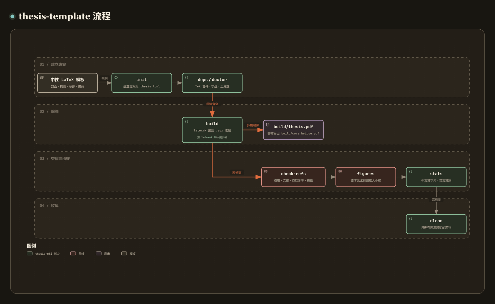

# thesis-cli — 碩士論文 LaTeX 模板與建置、稽核工具

[](https://github.com/recklight/thesis-template/actions/workflows/ci.yml)
[](https://www.python.org/downloads/)
[](LICENSE)

[English](README.md) | 繁體中文

一份中性的碩士論文 LaTeX 排版模板，加上一組用 Python 寫的建置與稽核 CLI `thesis-cli`。中性的意思是不綁任何一間學校：校名、系所與所有姓名都是佔位文字（`○○大學`、`○○學系`），等你自己填。

模板負責排版：封面、書名頁、摘要、目錄、章節、參考文獻、附錄、書背。CLI 負責編譯、檢查與清理，每個指令都有固定的退出碼，可以直接放進 CI。

作者：RL

---

## 目錄

- [專案簡介](#專案簡介)
- [安裝](#安裝)
- [快速開始](#快速開始)
- [方法說明](#方法說明)
- [使用範例](#使用範例)
- [指令說明對照表](#指令說明對照表)
- [專案結構](#專案結構)
- [設定檔 thesis.toml](#設定檔-thesistoml)
- [資料準備](#資料準備)
- [退出碼與 CI 整合](#退出碼與-ci-整合)
- [輸出格式](#輸出格式)
- [設計重點](#設計重點)
- [開發與測試](#開發與測試)
- [References](#references)
- [License](#license)

---

## 專案簡介

```
thesis-cli init     從中性模板建立新專案
thesis-cli deps     編譯前先確認 TeX 套件、程式與字型都在
thesis-cli doctor   診斷 Python 環境、專案結構與工具鏈
thesis-cli build    編譯論文（或書背），自動跑足夠的輪數
thesis-cli check-refs  稽核引用、參考文獻、交互參照與標籤
thesis-cli figures  解析每一張圖，抓出大小寫與路徑錯誤
thesis-cli stats    中英混排字數統計（中文算字元、英文算詞）
thesis-cli clean    只刪建置產物，不碰原始檔
```

[](https://raw.githack.com/recklight/thesis-template/master/docs/workflow.zh-TW.html?theme=dark)

互動式流程圖：[線上瀏覽](https://raw.githack.com/recklight/thesis-template/master/docs/workflow.zh-TW.html?theme=dark)，或在本機用瀏覽器開啟 [`docs/workflow.zh-TW.html`](docs/workflow.zh-TW.html)。圖可以縮放、搜尋，也能標出兩個步驟之間的路徑，例如從 `init` 到 `build/thesis.pdf`。

各指令處理的，是 LaTeX 本身不擋、或只在記錄檔裡提一句的狀況：

| 狀況 | LaTeX／BibTeX 的反應 | 結果 | 處理的指令 |
| --- | --- | --- | --- |
| 少跑一輪編譯 | 只在 `.log` 留一行警告 | 交互參照印成 `??` | `build` |
| `\cite` 的 key 不在任何 `.bib` | 警告 | 引用印成 `[?]` | `check-refs` |
| `.bib` 裡有條目從沒被引用 | 不報 | 該筆不會出現在參考文獻 | `check-refs` |
| 兩個 `.bib` 有同名但內容不同的 key | 只在 `.blg` 留一行 `Repeated entry` | 用的是先讀到的那一筆 | `check-refs` |
| 圖檔路徑大小寫不符 | 在 Windows/NTFS 上正常 | 搬到 Linux CI 編譯失敗 | `figures` |
| 缺少 CJK 字型的某個 subfont | 退出碼 0，只在 `missfont.log` 留痕跡 | 字型被替換卻沒人發現 | `deps`、`build` |
| 把沒有 preamble 的片段檔直接編譯 | 滿屏 `Undefined control sequence` | 訊息指不到真正的錯誤 | `build` |
| 建置產物與原始碼混在同一層 | 不報 | 別的文件的 `.aux` 被一起帶著走 | `build`、`clean` |

稽核指令都支援 `--strict`（把警告升級成失敗）與 `--json`（給腳本讀），在終端機前用和放進 CI 用的是同一組指令。

---

## 安裝

需求：**Python 3.10 以上**，以及一套 TeX 發行版（TeX Live、MiKTeX 或 MacTeX）。
沒有安裝 TeX 也可以跑稽核指令；只有 `build` 與 `doctor` 的 smoke test 需要編譯器。

`thesis-cli` 沒有發佈到 PyPI，請從原始碼安裝：

```bash
git clone https://github.com/recklight/thesis-template.git
cd thesis-template

# 一般安裝
pip install .

# 開發用（可編輯模式，含 pytest 與 ruff）
pip install -e ".[dev]"
```

Python 相依套件只有四個：`numpy`、`typer`、`rich`、`tomli`。

安裝完成後確認環境：

```bash
thesis-cli doctor
```

`doctor` 會依序檢查 Python 版本與套件、專案結構、TeX 工具鏈，
最後編譯一份最小的中文文件當作 smoke test（放在暫存資料夾，不留任何檔案）。
在專案資料夾外執行時，它略過專案結構，只用內建的預設設定檢查這台機器。

---

## 快速開始

```bash
# 1. 建立新論文專案（互動式填入姓名、題目、系所）
thesis-cli init ~/my-thesis --interactive
cd ~/my-thesis

# 2. 確認 TeX 環境齊全
thesis-cli deps

# 3. 編譯
thesis-cli build

# 4. 交稿前的完整檢查
thesis-cli check-refs --strict
thesis-cli figures --strict
thesis-cli stats

# 5. 清掉建置產物
thesis-cli clean
```

編譯出來的 PDF 在 `build/thesis.pdf`。
書背列印檔另外編譯：

```bash
thesis-cli build --target spine
```

---

## 方法說明

### 1. 中英混排字數統計

以空白切詞對中文沒有意義（整段沒有空白，會被當成一個詞）；
只數字元對英文摘要也沒有意義。所以 `stats` 把兩者分開算：

- 中文：逐字元計算，判定依據是 Unicode 的 CJK 區段
  （`U+4E00–U+9FFF` 主區、Extension A–J、兩個相容表意文字區段），
  再加上 CJK 符號與標點區段（`U+3000–U+303F`）裡的字母與數字，例如「々」和「二〇二四」的「〇」。
- 英文：把 CJK 字元當成空白，再以空白切詞，只計入含有英數字的詞。
- 標點：單獨計算，兩邊都不算。範圍是 `U+3001–U+303F` 裡屬於標點與符號的碼位、
  直排標點（`U+FE10–U+FE1F`）、CJK 相容形式（`U+FE30–U+FE4F`）與全形 ASCII 的標點段。
  兩個例外刻意不算標點：全形數字（`U+FF10–U+FF19`）是數字，計入英文詞；
  全形空白（`U+3000`）是空白，不計入任何一邊，也不計入字元總數。

判定是向量化的。設 $c_i$ 為第 $i$ 個字元的碼位，
把所有 CJK 區段的邊界攤平成一個排序好的陣列

$$
E = [\,s_0,\; e_0+1,\; s_1,\; e_1+1,\; \dots\,]
$$

則字元屬於 CJK 的條件是

$$
\operatorname{searchsorted}(E,\, c_i,\, \text{right}) \bmod 2 = 1
$$

整段文字先編成 UTF-32LE，再把這串位元組直接讀成一個碼位陣列；
接著只要一次 `np.searchsorted` 就判定完所有字元是不是 CJK，全程沒有逐字元的 Python 迴圈。

統計之前會先剝掉註解、數學模式、`lstlisting` 區塊、所有指令名稱與環境名稱，
以及「參數是識別字或設定、不是內文」的參數：`\label{}`、`\cite{}`、`\ref{}` 的內容、
`\fig` 系列巨集的寬度、檔名與標籤、表格的欄位格式、只有數字或長度的參數。
不剝的話，`\label{sec:sampling-rate}` 會被當成一個英文詞，`\chapter{緒論}` 會多出一個 `\chapter{`。
`\caption` 的圖說與 `\figt` 的附加說明是內文，照算。

### 2. 交互參照四向比對

`check-refs` 比對四個集合，任何一邊落單都是問題：

| 比對 | 抓到的錯誤 | 嚴重度 |
| --- | --- | --- |
| `\cite` 的 key ∉ `.bib` | 引用會印成 `[?]` | error |
| `.bib` 的 key ∉ 任何 `\cite` | 該筆不會進參考文獻 | warning |
| `\ref` 的目標 ∉ `\label` | 交互參照會印成 `??` | error |
| `\label` 重複定義 | 只在 `.log` 留警告，參考指向其中一個 | error |

另外還會讀上一次編譯留下的 `.aux`。若原始碼裡的引用在 `.aux` 裡找不到，
代表磁碟上的 PDF 已經過期（stale aux）。

### 3. 圖檔解析與大小寫檢查

`\includegraphics{figures/case_1_test.eps}` 對上磁碟的 `Case_1_test.eps`，
在 Windows 與預設的 macOS 卷宗上完全正常，搬到 Linux CI 就編譯失敗。

解析器不問檔案系統「這個檔案存不存在」，因為那個答案在不同平台上不一樣。
它列出每一層目錄的內容（`Path.iterdir()`），再拿要求的路徑逐層做逐字元比對。
資料夾名稱和檔名一樣要比，`Figures/plot.png` 對上 `figures/` 資料夾也算大小寫不符。

- 完全相符 → `ok`
- 只有忽略大小寫才相符 → `case-mismatch`（error，並印出磁碟上的真實路徑）
- 都找不到 → `missing`（error，並列出試過哪些路徑）
- 檔名由巨集組成（例如浮水印） → `macro`（info，靜態無法解析，交給 `build` 檢查）

沒有副檔名時，依 `thesis.toml` 的 `figures.extensions` 順序逐一探測，
模擬 LaTeX 的 `\DeclareGraphicsExtensions` 行為。
寫了副檔名就只認那個檔，graphicx 不會拿 `plot.pdf` 代替 `plot.png`；
唯一的例外是 `.eps`：pdfLaTeX 會用 `epstopdf` 轉出的 `plot-eps-converted-to.pdf`。
反向掃描則列出「放在圖檔資料夾但沒有任何地方引用」的檔案；
`*-eps-converted-to.pdf` 被認定為衍生物，不列入未使用清單，但會列入 `clean` 的刪除清單。

### 4. 多輪編譯收斂

交互參照與文獻編號需要兩輪以上才會收斂：
第一輪把號碼寫進 `.aux`，第二輪才讀得到；`bibtex` 產生 `.bbl` 之後還要再一輪。

`build` 預設把輪數交給 `latexmk` 決定（它會一直跑到 `.aux` 沒有變化為止）。
沒裝 `latexmk` 的環境會退回固定的手動序列，引擎總共跑 `build.max_passes` 輪（預設 4）：

```
engine → bibtex → engine → engine → engine
```

第一輪之後 `.aux` 裡沒有 `\bibdata`（例如書背，或沒有參考文獻的文件）就跳過 `bibtex`；
`bibtex` 只有警告時（退出碼 1）不算失敗。
沒裝 `bibtex` 的話，`build` 只記一則警告、略過這一步，照樣往下編譯。

支援 `latex+dvipdfmx` 這條路線，是因為長論文用它最快：
`pdflatex` 每一輪都要嵌入字型，前幾輪都是白做工，`dvipdfmx` 只在最後一步嵌入。

### 5. 安全的清理規則

`clean` 是整套工具裡唯一會刪東西的指令，所以規則寫死而且很窄：

1. 只在有 `thesis.toml` 的專案裡執行，候選檔案必須在專案根目錄底下（路徑先 resolve 再比對，符號連結不跟）。
2. 只有在「產生它的原始檔還在」時才刪。
   `thesis.aux` 可以刪，因為 `thesis.tex` 在；
   `build/thesis.aux` 的原始檔是根目錄的 `thesis.tex`，`build/coverbridge.aux` 是設定的書背原始檔；
   孤兒 `other_project.aux` 不刪，因為沒有證據說它是這個專案的產物。
3. 原始檔永遠不是候選：`.tex`、`.cls`、`.sty`、`.bib`、`.bst`、所有圖片格式，
   任何設定都不能把它們變成候選。
4. 完稿 PDF 只有在 `--outputs` 或設定裡明講時才刪。

刪除計畫可以先看不執行（`--dry-run`）。

---

## 使用範例

### CLI

```bash
# 交稿前的完整檢查，把警告也當失敗（適合放在 CI）
thesis-cli check-refs --strict
thesis-cli figures --strict

# 只看章節的字數，輸出 JSON 給腳本
thesis-cli stats --only-chapters --json | python -c "import json,sys; d=json.load(sys.stdin); print(d['summary']['cjk_chars'])"

# 指定另一個專案目錄，不必先 cd 過去
thesis-cli -C ~/my-thesis build

# 臨時換引擎，不改 thesis.toml
thesis-cli build --engine pdflatex

# 不用 latexmk，跑固定的手動序列
thesis-cli build --no-latexmk

# 先看會刪什麼，確認之後再真的刪
thesis-cli clean --dry-run --show-skipped
thesis-cli clean
```

### Python API

CLI 只是一層薄殼，每個子指令背後都是一個「吃設定、吐報告」的函式，
不印東西也不呼叫 `sys.exit`，可以直接當函式庫用：

```python
from pathlib import Path

from thesis_cli import (
    audit_figures,
    check_references,
    collect_statistics,
    load_config,
    scan_document,
)

# 讀 thesis.toml（會從指定目錄往上層找）
config = load_config(Path("~/my-thesis").expanduser(), required=True)

# 展開整份文件：跟著 \input / \include 遞迴，抓出引用、標籤、圖檔
document = scan_document(
    config.main_path,
    config.root,
    macros=config.figure_macros,
    label_macros=config.label_macros,
)
print(f"共 {len(document.files)} 個檔案，{len(document.cited_keys())} 個引用 key")

# 交互參照稽核
refs = check_references(config, document=document)
for finding in refs.sorted_findings():
    print(f"[{finding.severity.value}] {finding.location}：{finding.message}")

# 圖檔稽核：抓大小寫不符
figures = audit_figures(config, document=document)
print("大小寫不符：", figures.summary["case_mismatch"])

# 字數統計
stats = collect_statistics(config, document=document)
print("中文字數：", stats.summary["cjk_chars"])
print("英文詞數：", stats.summary["latin_words"])

# 報告可以直接轉 JSON，或問它該用什麼退出碼
print(refs.to_json())
raise SystemExit(refs.exit_code(strict=True))
```

單獨使用某個解析器也可以，它們都是純函式，吃字串就能跑：

```python
from thesis_cli import count_text, parse_aux_text, parse_bib_text

print(count_text("室內定位 uses radio maps."))
# TextCounts(cjk_chars=4, latin_words=3, cjk_punctuation=0, characters=18)

db = parse_bib_text("@article{k, author={B. Writer, }, title={T}, journal={J}, year={2004}}")
print([p.kind.value for p in db.problems])
# ['trailing-comma-in-names']

aux = parse_aux_text(r"\newlabel{eq:a}{{2.1}{6}{Title}{equation.2.1.1}{}}")
print(aux.labels[0].number, aux.labels[0].anchor)
# 2.1 equation.2.1.1
```

### 完整示範腳本

`examples/audit_synthetic_thesis.py` 會自己生出一份論文專案、
故意埋下四個典型缺陷、跑完所有稽核、修好、再跑一次驗證。
完全不需要 TeX，也不讀任何真實資料：

```bash
python examples/audit_synthetic_thesis.py
```

---

## 指令說明對照表

| 指令 | 用途 | 常用選項 |
| --- | --- | --- |
| `init <目錄>` | 從中性模板建立新專案 | `--interactive`、`--set cTitle=題目`、`--template <目錄>`、`--force` |
| `deps` | 檢查 TeX 套件／程式／字型 | `--strict`、`--json` |
| `doctor` | 診斷環境、專案與工具鏈 | `--no-smoke`、`--strict`、`--json` |
| `build` | 編譯論文或書背 | `--target thesis\|spine`、`--engine`、`--no-latexmk`、`--no-preflight`、`--strict` |
| `check-refs` | 引用／文獻／參考／標籤四向比對 | `--no-aux`、`--strict`、`--json` |
| `figures` | 圖檔解析與大小寫檢查 | `--no-unused`、`--strict`、`--json` |
| `stats` | 中英混排字數統計 | `--only-chapters`、`--all-files`、`--strict`、`--json` |
| `clean` | 刪除建置產物 | `--dry-run`、`--outputs`、`--show-skipped` |

`build`、`check-refs`、`figures`、`stats`、`clean` 需要 `thesis.toml`，找不到就以退出碼 2 結束；
`deps` 與 `doctor` 檢查的是這台機器，沒有專案時用預設設定。

全域選項（放在子指令之前）：

| 選項 | 說明 |
| --- | --- |
| `-C, --project <目錄>` | 指定專案目錄，預設從現行目錄往上層找 `thesis.toml` |
| `-v, --verbose` | 增加訊息量，可重複（`-vv` 為 debug） |
| `-q, --quiet` | 只顯示錯誤 |
| `--version` | 顯示版本 |

> 診斷訊息與 `init --interactive` 的提問都寫到 stderr，`--json` 只寫 stdout，
> 所以 `thesis-cli stats --json | jq` 不需要額外過濾。

---

## 專案結構

```
thesis-template/
├── pyproject.toml              # 套件定義、ruff 與 pytest 設定
├── README.md                   # 英文說明
├── README.zh-TW.md             # 繁體中文說明（本檔）
├── CHANGELOG.md / CONTRIBUTING.md / CITATION.cff
├── LICENSE                     # MIT, Copyright (c) 2026 RL
├── .gitignore                  # 建置產物、編輯器備份、資料檔
├── make_snippets.py            # 產生 snippets 與佔位圖（模板的建置腳本）
│
├── src/thesis_cli/             # Python 套件
│   ├── __init__.py             # 公開 API 的 re-export
│   ├── __main__.py             # python -m thesis_cli
│   ├── py.typed                # 型別標記
│   ├── cli.py                  # typer app，掛載八個子指令
│   ├── config.py               # thesis.toml 的 schema 與 dataclass
│   ├── errors.py               # 例外階層與退出碼對照
│   ├── logging_utils.py        # logging 設定（只在 CLI 進入點做一次）
│   ├── report.py               # 統一的報告模型：表格與 JSON 雙輸出
│   ├── latex/
│   │   ├── engine.py           # latexmk / 各引擎 / bibtex / dvipdfmx 的包裝
│   │   ├── log_parser.py       # .log 訊息分類（含 79 字元折行還原）
│   │   └── artifacts.py        # 建置產物判定與安全刪除
│   ├── parsers/
│   │   ├── tex_scanner.py      # 剝註解／數學／listings，展開 \input，抽取引用
│   │   ├── aux_parser.py       # .aux 平衡括號掃描（相容 hyperref 五欄）
│   │   ├── bib_parser.py       # .bib 解析與資料品質稽核
│   │   └── cjk.py              # CJK 區段判定與中英混排字數統計
│   └── commands/               # 一個子指令一個模組
│       ├── build.py            ├── check_refs.py   ├── clean.py
│       ├── deps.py             ├── doctor.py       ├── figures.py
│       ├── init_project.py     └── stats.py
│
├── template/                   # LaTeX 模板本體（init 會複製這一份）
│   ├── .gitignore              # 新專案一建立就有，涵蓋 clean 會刪的檔案類型
│   ├── thesis.tex              # 主檔，唯一可以直接編譯的檔案
│   ├── thesis_report.cls       # 文件類別：章節置中、中文章別、目錄點線
│   ├── thesis.toml             # 模板自己的專案設定
│   ├── config/
│   │   ├── cjk.tex             # 依引擎選 xeCJK 或 CJKutf8
│   │   ├── names.tex           # 唯一需要你填的檔案
│   │   ├── definitions.tex     # 預設值與所有標題名稱（中英一次設定到底）
│   │   ├── chapter_numbering.tex  # 三種目錄格式與附錄章號的具名巨集
│   │   ├── watermark.tex       # 浮水印，all / selected / off
│   │   ├── headerfooter.tex    # 頁首頁尾與雙段頁碼
│   │   └── generated.tex       # 由 thesis.toml 產生，不要手改
│   ├── macros/figure_macros.tex   # \fig / \hfig / \mpfig 巨集家族
│   ├── structure/              # frontpages / backpages / chapters / coverbridge
│   ├── chapters/               # ch1–ch5 章節骨架
│   ├── content/                # 摘要、誌謝、符號說明、附錄、自傳
│   ├── bib/references.bib      # 七筆格式正確的示範條目
│   ├── figures/                # 中性佔位圖（程式產生）
│   └── snippets/               # 11 個可直接複製貼上的片段
│
├── docs/
│   ├── images/workflow.png     # 英文版流程圖（README.md）
│   ├── images/workflow.zh-TW.png  # 本 README 的流程圖
│   ├── workflow.html           # 英文版互動式流程圖
│   └── workflow.zh-TW.html     # 互動式流程圖（瀏覽器開啟）
│
├── examples/
│   └── audit_synthetic_thesis.py  # 完全用合成資料的端到端示範
│
└── tests/                      # 535 個測試，全部用程式合成的 fixture
    ├── conftest.py             # 共用 fixture，專案全部由字串組出來
    ├── test_*.py               # 共 17 個測試檔
    └── fixtures/minimal_thesis/   # doctor 的 smoke test 文件
```

---

## 設定檔 thesis.toml

所有路徑都相對於 `thesis.toml` 所在的目錄。
**絕對路徑會被拒絕**（包含 `/etc` 這種在 Windows 上 `Path.is_absolute()` 回傳 False 的寫法），
因為絕對路徑會讓專案無法搬移也無法分享。

```toml
[project]
main = "thesis.tex"          # 主檔；build 會拒絕沒有 preamble 的檔案

[build]
engine = "xelatex"           # xelatex | pdflatex | latex+dvipdfmx
use_latexmk = true           # 交給 latexmk 決定要跑幾輪
max_passes = 4               # 沒有 latexmk 時，手動序列跑幾輪引擎
interaction = "nonstopmode"
halt_on_error = true
synctex = false
output_dir = "build"         # 建置產物不與原始碼混在一起
spine_source = "structure/coverbridge.tex"

[bib]
files = ["bib/references.bib"]
style = "ieeetr"             # check-refs 會與 \bibliographystyle 比對

[figures]
dirs = ["figures"]
extensions = [".pdf", ".png", ".jpg", ".jpeg", ".eps"]   # 無副檔名時的探測順序
derived_suffixes = ["-eps-converted-to.pdf"]             # epstopdf 的衍生物

[figures.macros]             # 自訂巨集 → 檔名參數是第幾個（1-based）
# myfig = 3

[figures.label_macros]       # 自訂巨集 → 標籤參數是第幾個
# myfig = 5

[template]
toc_style = "cjk_full"       # arabic（\chaptername 1）| cjk（一、）| cjk_full（第一章）
watermark = "all"            # all | selected | off
watermark_image = "figures/watermark_placeholder.png"
watermark_width = "5.1cm"    # 200×200 px @ 100 dpi ≈ 5.08 cm
watermark_x = "-1"           # 相對於中央頁首的偏移，單位為英吋
watermark_y = "-6.2"
float_spec = "htbp"          # 圖表巨集的預設浮動位置
generated_file = "config/generated.tex"

[clean]
extra_patterns = ["*.bak", "*.asv", "Thumbs.db", ".DS_Store"]
remove_outputs = false       # 完稿 PDF 只有明講時才刪

[deps]
cjk_font = "Noto Serif CJK TC"               # XeLaTeX 用，以 fc-list 檢查
legacy_font_files = ["bkai00mp.tfm", "bsmi00lp.tfm"]   # CJK 套件路線用

[stats]
chapter_dir = "chapters"     # 這兩個資料夾底下的檔案，以及開了 \chapter 或 \section 的檔案，算內文
content_dir = "content"
```

`arabic` 格式的章標題是 `\chaptername` 加數字：預設的 `\ThesisLabelsChinese` 印成「章 1」，
`\ThesisLabelsEnglish` 印成「Chapter 1」。附錄的章號是字母，三種格式都印成 `\appendixname` 加字母：
預設的 `\ThesisLabelsChinese` 印成「附錄 A」，`\ThesisLabelsEnglish` 印成「Appendix A」。

### `[template]` 是怎麼進到 LaTeX 的

`build` 會把 `[template]` 這一段寫成 `config/generated.tex`，
主檔用 `\input` 讀進來：

```latex
\ThesisTocStyleCJKFull
\renewcommand{\thesisFloatSpec}{htbp}
\renewcommand{\thesisWatermarkImage}{figures/watermark_placeholder}
\setlength{\thesisWatermarkWidth}{5.1cm}
\renewcommand{\thesisWatermarkX}{-1}
\renewcommand{\thesisWatermarkY}{-6.2}
\ThesisWatermark{all}
```

格式切換寫在 `thesis.toml`，`build` 把它寫成 `generated.tex`，LaTeX 原始碼不必為了換格式而改。
`generated.tex` 有 do-not-edit 標頭，而且內容沒變時不會重寫
（重寫會更新 mtime，害 `latexmk` 每次都整份重編）。

---

## 資料準備

這個專案不需要任何研究資料，但下面四樣東西要自己準備。

### 1. 你自己的資料（如果論文裡有）

資料放在哪裡由你決定，模板的 `.tex` 檔不會指向任何資料路徑。
建議放在版本控制之外（`.gitignore` 已經擋掉 `data/`、`*.mat`、`*.wav`、`*.xlsx` 等），
用你自己的分析腳本產生圖檔，再把圖檔放進 `figures/`。

### 2. 圖檔

- 放在 `figures/`（可在 `thesis.toml` 的 `figures.dirs` 改）。
- 格式：`.pdf`、`.png`、`.jpg`、`.eps` 都可以。
  XeLaTeX 與 pdfLaTeX 建議用 `.pdf` 或 `.png`；
  `latex+dvipdfmx` 路線用 `.eps`。
- **引用時建議不寫副檔名**（`\fig{0.8}{figures/plot}{...}{fig:plot}`），
  讓 `\DeclareGraphicsExtensions` 自動挑，換引擎時不用改原始碼。
- 路徑的大小寫（資料夾也算）務必與磁碟一致。不確定就跑 `thesis-cli figures`。

### 3. 浮水印

校方通常會提供一個 200×200 px 的圖檔。放到 `figures/`，
在 `thesis.toml` 指向它。不需要浮水印就設 `watermark = "off"`，
這樣圖檔完全不會被載入。
`watermark = "selected"` 時只有寫了 `\ThesisWatermarkThisPage` 的那一頁有浮水印，
例如放在封面的 `\ThesisUnnumberedPage` 之後。

模板附的 `figures/watermark_placeholder.png` 與 `figures/example_fig.png`
是程式產生的中性佔位圖（見 `make_snippets.py`），沒有任何機構識別資訊。

### 4. 你的個人資料

只有一個檔案：`config/names.tex`。
題目、姓名、指導教授、系所、口試年月、關鍵詞全部在裡面，每個欄位上方都有用途註解。
留空的欄位（例如第二位共同指導教授）完全不佔版面，也不會留下空行。

```bash
# 互動式填寫
thesis-cli init ~/my-thesis --interactive

# 或用參數一次帶
thesis-cli init ~/my-thesis --set cTitle=論文題目 --set myCname=你的姓名
```

值是純文字，`%`、`&`、`_`、`{` 這類 LaTeX 特殊字元會自動跳脫（`50%` 寫進檔案是 `50\%`）。
`init` 完成後會告訴你還有哪些欄位停留在預設佔位值。

---

## 退出碼與 CI 整合

每一種失敗都有固定的退出碼，可以直接寫進 CI：

| 碼 | 意義 |
| --- | --- |
| 0 | 成功 |
| 1 | 一般錯誤 |
| 2 | `thesis.toml` 缺漏或格式錯誤 |
| 3 | 設定指向的檔案或資料夾不存在 |
| 4 | 找不到外部程式（引擎、`dvipdfmx`） |
| 5 | 編譯失敗（含 preflight 擋下） |
| 6 | 輸入不合法（例如拿片段檔當主檔編譯） |
| 7 | 稽核發現問題（`--strict` 時警告也算） |

GitHub Actions 範例：

```yaml
- name: 檢查 TeX 環境
  run: thesis-cli deps --strict

- name: 交互參照與文獻稽核
  run: thesis-cli check-refs --strict

- name: 圖檔解析（大小寫錯誤在 Windows 上不會壞，到 Linux 才會）
  run: thesis-cli figures --strict

- name: 編譯
  run: thesis-cli build --strict

- name: 字數
  run: thesis-cli stats --json > wordcount.json
```

---

## 輸出格式

每個稽核指令都回傳同一種 `CommandReport` 物件，所以 JSON 結構是一致的。
下面是模板裡某一筆文獻沒有被引用時的 `check-refs --json`（路徑省略）：

```json
{
  "command": "check-refs",
  "summary": { "main": "...", "bib_files": ["..."], "aux": "not read",
               "cited_keys": 6, "bib_entries": 7, "labels": 25, "references": 11 },
  "counts": { "error": 0, "warning": 1, "info": 0 },
  "findings": [
    {
      "severity": "warning",
      "kind": "unused-bib-entry",
      "message": "Bibliography entry 'unicode2023standard' is never cited.",
      "location": "references.bib:76",
      "detail": "Unused entries do not appear in the reference list; remove them or cite them."
    }
  ],
  "tables": [ { "title": "Sources", "columns": [...], "rows": [...] } ]
}
```

各指令 `summary` 的主要欄位：

| 指令 | 欄位 |
| --- | --- |
| `check-refs` | `cited_keys`、`bib_entries`、`labels`、`references`、`aux` |
| `figures` | `references`、`ok`、`case_mismatch`、`missing`、`macro_paths`、`unused` |
| `stats` | `cjk_chars`、`latin_words`、`combined`、`chapters`、`figures`、`tables`、`equations`、`citations` |
| `build` | `engine`、`driver`、`passes`、`log_errors`、`log_warnings`、`worst_overfull_pt`、`rerun_requested` |
| `clean` | `candidates`、`removed`、`spared`、`bytes`、`by_reason` |
| `deps` | `engine`、`checked`、`missing`、`packages_required`、`kpsewhich` |

`stats` 的 `chapters` 只算有編號的章（`\chapter*` 的摘要、目錄不算）；
`figures` 包含 `figure` 環境與 `\fig`、`\figt`、`\figtr`、`\hfig` 系列做出的圖；
`equations` 是顯示數學區塊的數目，多行的 `align` 算一個。

`findings[].kind` 是穩定的機器可讀分類，例如
`undefined-citation`、`unused-bib-entry`、`undefined-reference`、`duplicate-label`、
`bib-mismatch`、`figure-case-mismatch`、`figure-missing`、`figure-unused`、`conflicting-duplicate`、
`trailing-comma-in-names`、`malformed-year`、`stale-aux`、`missing-font`、
`overfull-hbox`、`empty-chapter`。

---

## 設計重點

這一節記錄這套工具在「手動編譯、人工檢查」之外多做的事，以及為什麼寫成程式而不是一句叮嚀。

### 建置流程

1. 編譯輪數不用自己數。`build` 會一直編到交互參照收斂（見方法說明 §4），
   不會因為少跑一輪而交出印著 `??` 的 PDF。
2. 引擎寫在 `thesis.toml`，模板端用 `iftex` 套件直接問正在跑的是哪個引擎。
3. 書背的 landscape 旗標自動帶上：`dvipdfmx` 需要 `-l` 才能正確擺放書背，
   `--target spine` 會自動加上。
4. preflight：圖檔、`.bib`、浮水印在啟動 TeX 之前就先檢查，缺什麼直接講，
   不讓 TeX 在後面丟一個指不到真正錯誤的訊息。
5. 拒絕編譯片段檔。`build` 先確認目標有 `\documentclass` 與 `\begin{document}`。
   對沒有 preamble 的章節檔、甚至對 `.bib` 跑引擎，都只會得到滿屏
   `Undefined control sequence`；先檢查這兩個標記，錯誤訊息就只剩一句話。
6. `.log` 訊息分類：先還原 TeX 在第 79 字元的硬折行
   （不還原的話，跨過折行的訊息會比對不到），再把 `file:line:error`、Overfull hbox、
   undefined reference、缺字型分類成摘要表。

### 資料品質

7. 兩個 `.bib` 出現同名 key 時，BibTeX 用先讀到的那一筆，
   其他的只在 `.blg` 留一行 `Repeated entry`。
   `check-refs` 把內容相同的記成 warning、內容不同的記成 error。
8. `.bib` 欄位稽核：必填欄位缺漏、欄位空白、作者名尾端多逗號
   （BibTeX 只在 `.blg` 報「has a comma at the end」並把它當錯誤計數），
   以及 `year` 欄塞了整段書目，這種 BibTeX 會照原樣印出來。
9. `check-refs` 比對原始碼的 `\bibliography` 與 `\bibliographystyle`、
   `thesis.toml` 的 `bib.files` 與 `bib.style`、以及 `.aux` 的 `\bibdata` 與 `\bibstyle`，
   不一致就警告。路徑整段比對，`old/references` 和 `bib/references` 不會被當成同一個檔。
10. `check-refs` 也會讀上一次編譯的 `.aux`，在那之後才加的引用會報成 stale aux（見方法說明 §2）。

### 圖檔

11. 方法說明 §3 的大小寫比對不依賴檔案系統的大小寫行為，
    所以在 Windows 上也抓得到搬到 Linux CI 才會壞的案例。這一點有專門的回歸測試。
12. 沒有任何地方引用的圖檔也會列出來，靠的是方法說明 §3 的反向掃描。
13. `-eps-converted-to.pdf` 算建置產物，不算素材（見方法說明 §3）。
14. 巨集也算引用。圖檔可能藏在 `\fig`、`\mpfiga` 這類巨集的第 2 或第 3 個參數裡，
    掃描器帶一張「巨集名 → 參數位置」表，而且這張表可以在 `thesis.toml` 擴充。
    標籤同理：`\fig{...}{...}{...}{fig:x}` 定義的 `fig:x` 會被正確登記，
    而巨集定義裡的 `\label{#4}` 不會被誤認成一個叫 `#4` 的標籤。

### 專案衛生

15. 產物與原始碼分家。建置產物進 `build/`，`init` 建立的每一個新專案都自帶 `.gitignore`，
    `clean` 會刪的檔案類型都在裡面（只有 `.ps` 例外：`build/` 之外的 `.ps` 多半是圖）。
16. 圖檔巨集只在 `macros/figure_macros.tex` 定義一次：浮動位置由 `thesis.toml` 的 `float_spec`（`\thesisFloatSpec`）決定，
    `r` 系列巨集一律裁切。
17. `.gitignore` 擋掉 `.bb`，因為 `ebb` 會在 `%%Title` 記下產生它那台機器的絕對路徑；模板裡也沒有這種檔案。
18. `init` 會把 `template/` 複製進每一個新專案，所以模板只放中性佔位文字，並有一組測試掃描整個 `template/`，
    出現絕對路徑、家目錄、電子郵件或學號格式的字串就讓測試失敗。
    檢查寫成樣式而不是黑名單，因為黑名單得把要擋的姓名與路徑寫進測試裡。

### 模板本身

19. 三種目錄章號格式是 `\ThesisTocStyleArabic` / `\ThesisTocStyleCJK` / `\ThesisTocStyleCJKFull`
    三個具名巨集，浮水印是 `\ThesisWatermark{all|selected|off}`，都由 `thesis.toml` 決定。
    附錄另有 `\ThesisAppendixNumbering`，字母章號不會被送進中文數字的轉換。
20. 選填欄位留空時不佔版面：共同指導教授 B/C、學院名、學號都是。
21. 模板的每一部分預設都會編進去，`stats` 會標出空的章節檔，
    另有測試在出現「有定義但從沒被用到」的 `\Thesis*` 巨集時失敗。
22. 本地化一次設定到底。`\ThesisLabelsChinese` / `\ThesisLabelsEnglish` 二選一，
    `\figurename`、`\tablename`、章別名稱與目錄標題一起切換，不會中英混雜。
23. 子圖用維護中的 `subcaption`；`hyperref` 在 CJK 設定之後載入，書籤才拿得到字型設定。
24. 字型缺失不會被吞掉。`deps` 在編譯前用 `kpsewhich` 驗證套件、
    用 `fc-list` 驗證 CJK 字型；`build` 之後還會讀 `missfont.log`，
    有字型被即時產生或替換就明講。

### 開發慣例

535 個測試用到的專案、文獻、log 與圖檔全部由程式產生，沒有一個讀真實論文。
涵蓋兩種 `\newlabel` 格式、三種壞掉的 `.bib` 資料、大小寫不符的回歸案例，
以及「只刪產物、不誤刪原始檔」的每一條規則。
docstring 裡的範例會當成 doctest 執行，範例過期就是測試失敗。
type hints 與 numpy 風格 docstring 是 CONTRIBUTING.md 的規定（CONTRIBUTING.md 與 CHANGELOG.md 都用繁體中文寫），套件也附 `py.typed`。

函式庫模組只用 `get_logger(__name__)` 取 logger，從不設定 logging；
logging 只在 CLI 進入點設定一次：診斷訊息走 stderr，`--json` 走 stdout。
`thesis.toml` 讀檔時就檢查，未知鍵、型別錯誤、超出範圍或絕對路徑全部擋下，錯誤訊息附上合法值。
CJK 區段表會先合併相鄰區間，再做方法說明 §1 的查表；
另有測試把 `U+33FFF` 以內（已經超過 Extension J 的結尾）的每個碼位，都跟逐字元判斷的簡單寫法對答案。
報告依嚴重度、分類、位置排序，JSON 欄位順序固定，
同樣的專案每次跑出同樣的輸出，兩次結果 diff 出來的就是實際差異。

---

## 開發與測試

```bash
cd thesis-template

# 全部測試（含 docstring 裡的範例）
python -m pytest -q

# 只跑某一個模組
python -m pytest tests/test_figures.py -v

# 靜態檢查與格式
python -m ruff check .
python -m ruff format --check .

# 端到端示範
python examples/audit_synthetic_thesis.py

# 重新產生 snippets 與佔位圖
python make_snippets.py
```

需要 TeX 的測試標了 `requires_latex`，沒裝的時候會自動跳過。

### 相容性

- 目標版本是 **Python 3.10**，本機開發環境可能更新，
  但語法與標準庫用法都守在 3.10 可用的範圍內
  （不用 `tomllib`、`StrEnum`、`typing.Self`、PEP 695 泛型語法等）。
- 程式碼同時相容 **NumPy 1.x 與 2.x**，不使用 2.0 已移除的別名。
- 相依版本下限：`numpy>=1.24`、`typer>=0.12`、`rich>=13.0`、`tomli>=2.0`。
  CI 有一個 job 用這組最舊的版本（typer 0.12 搭配 click 8.1）跑測試。

### LaTeX 相依套件

模板實際載入的套件（`deps` 會逐一用 `kpsewhich` 確認）：

`iftex`、`geometry`、`graphicx`、`fancyhdr`、`cite`、`amsmath`、`amssymb`、
`mathrsfs`、`listings`、`url`、`hyperref`、`morefloats`、`caption`、`subcaption`、
`setspace`、`epstopdf`、`rotating`、`xcolor`

依引擎再加上：

- XeLaTeX：`xeCJK`
- pdfLaTeX / latex+dvipdfmx：`CJKutf8`、`CJKnumb`

`latexmk` 沒裝時 `deps` 只記 warning，`build` 會改跑固定的手動序列。

---

## References

僅列出實際影響本專案設計的公開文獻與規格。

1. L. Lamport, *LaTeX: A Document Preparation System*, 2nd ed. Reading, MA:
   Addison-Wesley, 1994.
   — `report` 類別、`\appendix` 與 list 環境的行為；寫進 `.toc` 的內容要對 fragile 指令加 `\protect`，
   `thesis_report.cls` 的 `\numberline` 與附錄的章號欄寬都是這樣寫進目錄的。

2. D. E. Knuth, *The TeXbook*. Reading, MA: Addison-Wesley, 1984.
   — `\hbox` 與 overfull／underfull box 的定義，`log_parser` 的分類依據。

3. F. Mittelbach and M. Goossens, *The LaTeX Companion*, 2nd ed. Boston, MA:
   Addison-Wesley, 2004.
   — `config/definitions.tex` 的符號說明環境 `SymEntry`，
   採用書中所述「以固定寬度標籤盒建立 list 環境」的做法。

4. K. Reckdahl, *Using Imported Graphics in LaTeX and pdfLaTeX* (epslatex),
   CTAN, 2006.
   — `config/watermark.tex` 的 savebox + picture 環境作法，
   以及 `\DeclareGraphicsExtensions` 的副檔名探測順序，`figures` 指令照同樣的順序找檔。

5. The Unicode Consortium, *The Unicode Standard, Version 17.0.0*. South San Francisco, CA:
   The Unicode Consortium, 2025.
   — `parsers/cjk.py` 的區段邊界取自其 Blocks.txt：CJK Unified Ideographs、Extension A–J
   與兩個 Compatibility Ideographs 區段；`U+3001–U+303F` 依 General_Category 分成標點與文字。

---

## License

MIT License，Copyright (c) 2026 RL。詳見 [LICENSE](LICENSE)。

模板的 `thesis_report.cls` 建立在標準 `report` 類別之上，同樣採 MIT 授權；
其中 `\@chapter`、`\@makechapterhead` 與章節間距參數沿用 `report.cls` 的寫法。
